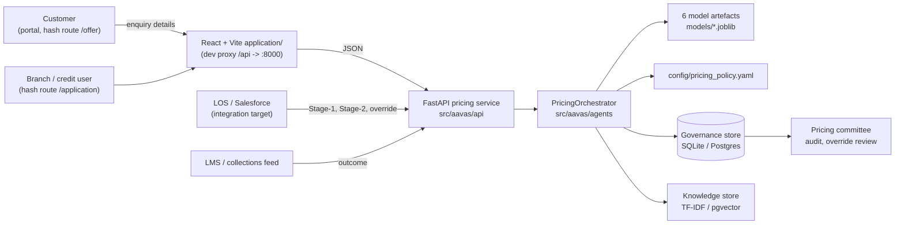
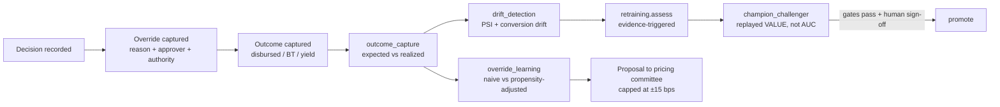

# Architecture

How the Aavas pricing engine is put together: the layers, what each component owns,
where a decision is made and where it is only recommended.

Companion documents: [flows.md](flows.md) (what happens, step by step),
[api-reference.md](api-reference.md), [data-model.md](data-model.md),
[operations.md](operations.md).

---

## 1. What the system does

One home-loan application is priced twice.

* **Stage 1 (pre-assessment).** Nothing is verified. The engine returns an *interval*
  (q10/q50/q90), an eligibility range and a confidence level, clamped into the product
  rate envelope.
* **Stage 2 (post-assessment).** Income, valuation, bureau, deviations and legal/technical
  outcomes are known. The engine simulates every permissible price, prices each one in
  rupees of risk-adjusted value, and recommends the value-maximising price subject to
  policy and to conversion/portfolio guard-rails.

Everything after that is governance: the human decision is captured beside the
recommendation (never instead of it), the outcome is captured against the decision, and
the learning loop reports what the overrides actually did.

The engine **recommends and explains; it never approves.** Every recommendation names the
lowest authority that may sign it, and `human_decision_required: true` is part of the
Stage-2 payload.

---

## 2. System context



Only the pricing service is in this repo's runtime scope. LOS, Salesforce and the LMS are
integration points: their contracts are the four POST endpoints in
[api-reference.md](api-reference.md).

---

## 3. Layers

```
┌──────────────────────────────────────────────────────────────────────────────┐
│ CHANNEL            application/  — React 19 + Vite SPA (hash routes)          │
│                    customer portal · assessment workspace · audit · learning  │
└───────────────────────────────┬──────────────────────────────────────────────┘
                                │  JSON over same-origin /api proxy
┌───────────────────────────────▼──────────────────────────────────────────────┐
│ API                src/aavas/api  — FastAPI                                   │
│   stage1.py  stage2.py  override.py  outcome.py  main.py (health, cards)      │
│   contracts.py = pydantic request contracts; deps.py = process-wide singletons │
└───────────────────────────────┬──────────────────────────────────────────────┘
                                │
┌───────────────────────────────▼──────────────────────────────────────────────┐
│ AGENT              src/aavas/agents — PricingOrchestrator                     │
│   underwriting → risk → policy → sales → pricing → policy → conversion        │
│                → explanation → (learning)                                      │
│   shared state: CustomerDigitalTwin (one row + enrichments + notes)           │
└───┬────────────────┬───────────────────┬───────────────────┬─────────────────┘
    │                │                   │                   │
┌───▼──────────┐ ┌───▼───────────────┐ ┌─▼───────────────┐ ┌─▼─────────────────┐
│ MODELS       │ │ OPTIMIZATION      │ │ XAI             │ │ KNOWLEDGE         │
│ stage1       │ │ constraints       │ │ shap_explainer  │ │ vector_store      │
│ stage2       │ │ scenario_generator│ │ reason_codes    │ │ policy_indexer    │
│ conversion   │ │ yield_calculator  │ │ counterfactual  │ │ sales_note_       │
│ prepayment   │ │ price_optimizer   │ │ omnixai_analysis│ │   retriever       │
│ risk         │ │                   │ │                 │ │                   │
│ override     │ │                   │ │                 │ │                   │
└──────────────┘ └───────────────────┘ └─────────────────┘ └───────────────────┘
┌──────────────────────────────────────────────────────────────────────────────┐
│ PLATFORM   features/ (contracts + transformer) · ingestion/ (schema, validate,│
│            load, split) · governance/ (store, audit, decision log, registry)  │
│            learning/ (outcome, override, drift, retrain, champion/challenger) │
│            analytics/ · federated/ · synthetic/ · config.py · paths.py        │
└──────────────────────────────────────────────────────────────────────────────┘
┌──────────────────────────────────────────────────────────────────────────────┐
│ DATA       config/*.yaml · data/raw + data/processed · models/*.joblib+card   │
│            aavas_governance.db (SQLite) · reports/omnixai/                    │
└──────────────────────────────────────────────────────────────────────────────┘
```

Import direction is strictly downward. No platform module imports an agent; no agent
imports the API.

---

## 4. The agent pipeline

[`PricingOrchestrator.process()`](../src/aavas/agents/orchestrator.py) is the whole Stage-2
decision. The **order is load-bearing**, not cosmetic:

| # | Agent | File | Owns | Why here |
|---|---|---|---|---|
| 0 | Underwriting | [underwriting_agent.py](../src/aavas/agents/underwriting_agent.py) | Builds `CustomerDigitalTwin`; infers the real stage from evidence present | Every later agent reads one object, so no two agents can disagree about the file |
| 1 | Risk | [risk_agent.py](../src/aavas/agents/risk_agent.py) | PD → grade → expected loss %, breakeven rate | The **grade it assigns is what the policy card rate is built from**, so it must precede policy |
| 2 | Policy (envelope) | [policy_agent.py](../src/aavas/agents/policy_agent.py) | Card rate, permissible band, affordability cap | Defines where the optimizer may search |
| 3 | Sales context | [sales_context_agent.py](../src/aavas/agents/sales_context_agent.py) | Competitor gap, target pressure, override risk, evidence status | Moves the conversion curve; anchored on card rate until a price exists |
| 4 | Pricing | [pricing_agent.py](../src/aavas/agents/pricing_agent.py) | Stage-2 anchor → scenario grid → scored table → recommendation | The actual decision step |
| 5 | Policy (enforce) | policy_agent.py | Re-validates and clamps the chosen price | A recommendation outside policy is clamped and flagged, never silently served |
| 6 | Sales context (again) | sales_context_agent.py | Re-reads context against the *recommended* price | Gap/override risk computed against the price actually being offered |
| 7 | Conversion | [conversion_agent.py](../src/aavas/agents/conversion_agent.py) | Elasticity, negotiation table, rate for 70%/50% conversion | Needs the final price as its centre point |
| 8 | Explanation | [explanation_agent.py](../src/aavas/agents/explanation_agent.py) | Reason codes, commercial-vs-risk split, value decomposition, caveats, fair-pricing flag | Reads everything above back |
| 9 | Decision log | [governance/decision_logger.py](../src/aavas/governance/decision_logger.py) | Append-only record + audit entry | Nothing is returned that is not recorded |

The Stage-1 path is shorter: underwriting (forced to `pre_assessment`) →
[preassessment_agent](../src/aavas/agents/preassessment_agent.py) → clamp to product
envelope → log.

The [learning agent](../src/aavas/agents/learning_agent.py) is not in the request path. It
runs on captured overrides/outcomes and the training table, and produces *proposals*, capped
at ±15 bps, routed to the pricing committee.

### The control plane

Every decision now carries a **step trace** ([agents/trace.py](../src/aavas/agents/trace.py)):
which agent ran, in what position, how long it took, and one line — composed from that agent's
own output, never invented — about what it produced. It rides along on the decision payload, so
it is persisted with the decision and readable later by `decision_id`. Nothing in the priced path
reads it; removing it changes no number.

The roster ([agents/roster.py](../src/aavas/agents/roster.py)) is declared rather than
introspected, because what matters about an agent — what it decides, which models it needs,
whether anything calls it — cannot be read off a class name. `tests/test_agents.py` asserts the
declaration and the code have not drifted, including that the **declared pipeline order equals the
order the orchestrator actually ran**.

Served at `GET /agents`, `/agents/traces`, `/agents/trace/latest` and `/agents/trace/{decision_id}`,
and shown in the admin view at `#/agents`. Two states it deliberately surfaces rather than hides:

* **dormant** — the three `aavas.acceptance` agents are implemented, tested and called by nothing.
  An agent that exists but never runs is a fact about the system, and a roster that omitted it
  would be describing a pipeline other than the one running;
* **degraded** — an agent whose model artefact is missing still runs and the engine falls back.
  That is the difference between "ready" and "the number on screen came from a fallback".

### The four reusable packages, and the kernel that separates them

Four agents are whole subsystems rather than pipeline steps — feature
engineering, AutoML, acceptance scoring and price optimisation — and each is
independently useful. `agents/packages.py` declares each one's public surface,
dependencies, owned config and reuse notes.

Measuring the real import graph before doing anything found the four were
**nearly independent already**, and that every cross-package edge was a single
pure function living wherever it was first written:

| Edge | What it actually was |
|---|---|
| `optimization → features` | two column-coercion helpers |
| `features → learning` | PSI |
| `automl → models` | group fairness |

None of those functions belonged to the package it sat in. They are now
`aavas.kernel`, which imports nothing from `aavas` except logging — a primitive
that needs config is not a primitive, and every agent would inherit the
dependency. **Peer coupling between the four is now zero.**

| Package | Standalone | Depends on |
|---|---|---|
| `aavas.features` | yes | kernel, config, ingestion |
| `aavas.automl` | yes | kernel, config |
| `aavas.optimization` | yes | kernel, config, ingestion |
| `aavas.acceptance` | **no** | + connectors, agents |

Acceptance is coupled on purpose: it calls `agents.capabilities` to check it may
reach a connector before reading a customer's own words. That edge is a control,
not an accident, and the manifest records the reason rather than removing it —
lifting the package means taking the permission model with it.

Moving the four directories would have renamed the problem; extracting the kernel
removed it. `tests/test_agent_boundaries.py` checks every claim against the actual
import graph in both directions, so a package that quietly grows a dependency
fails there rather than when somebody tries to lift it out. Each folder carries an
`AGENT.md` with its contract and an extraction checklist.

### Agents, tools and skills

Three registries, kept apart because the three things fail differently and are
governed differently — and conflating them produces a system that monitors its
arithmetic and does not notice its database is gone.

| | Question it answers | Failure mode | Governed by |
|---|---|---|---|
| **Agent** (`roster.py`) | who decided | the decision does not happen | the roster, approval, the trace |
| **Tool** (`capabilities.py`) | what it called that lives outside this process | **unavailable** — every tool names its fallback | availability monitoring; this is the MCP surface |
| **Skill** (`capabilities.py`) | what it worked out for itself | a bug | tests and a config version |

**The discriminator is that a tool can be unavailable and a skill cannot.** 17
tools across 8 kinds (model artefact, store, index, optional library, connector,
source registry, procedure, LLM) and 11 skills. Served at `GET /agents/tools`
and `GET /agents/skills`, with the three tabs on `#/agents`.

`tests/test_capabilities.py` enforces the split rather than documenting it:

* a tool must name what makes it unavailable **and** what runs instead;
* a skill must name its governing config and must have **no** fallback;
* a skill module may not import `governance.store`, `connectors` or a model
  artefact — this is what makes "a skill cannot be unavailable" true rather than
  merely asserted;
* an agent must declare every capability module it imports, **and** must not
  declare one it no longer imports. Both directions, so the registry cannot rot
  in either.

That last check earned its place immediately. Four modules were written as
skills and rejected by it: `acceptance.sources` reaches a connector, and
`outcome_capture`, `override_learning` and `retraining` all read the governance
store — `retraining.assess()` counts decisions as one of its four triggers. All
four are tools, and the test found that rather than a reviewer.

### The system of record

Twelve registries are the usual list. This repository has one of them in the
strict sense. `GET /system-of-record` audits all twelve on a distinction that
decides what each is worth:

| Kind | Count | What it can answer |
|---|---|---|
| **Registry** | 4 — agent, skill, tool, model | *as of a past moment*: the snapshot or card live when the decision was priced |
| **Per-decision data** | 1 — trace | as of that decision, because it is stored with it |
| **Versioned config** | 3 — policy, feature, connector | only while that version of the file still exists |
| **Absent** | 4 — knowledge, prompt, memory, dataset | nothing |

Five of the twelve answer a question about the past. Agent, skill and tool were
code declarations until the agent set became a registered object — see below.

Memory is absent because no agent carries state between decisions — an accurate
description rather than a gap to fill. The prompt "registry" is a `SYSTEM_PROMPT`
constant; it matters little today because the LLM is dormant, and it matters a
great deal the moment the extraction agent is wired in.

### The agent manifest

`governance/agent_registry.py` snapshots the agent, skill and tool declarations
plus the pipeline order into `agent_manifests` and stamps the snapshot id onto
every decision through `versions()`. That is what turns three code declarations
into registries: asked which skills an agent had when a decision was priced, the
chain reads the snapshot that ran rather than today's roster.

**The id is derived, not declared.** `ASET-2026.09-d076e1df` is a content hash
over the declaration. A hand-bumped version number is a promise someone has to
keep on every edit, and the one edit where they forget is the one that matters:
two different rosters would then share a version and the audit would say they
were the same. A hash simply changes. `tests/test_system_of_record.py` asserts
the property directly — it prices a decision, drops an agent from the roster,
republishes, and checks the old decision still reports the old manifest with
`is_current: false` and a diff naming what was dropped.

What the manifest deliberately does *not* cover is config. "Which roster ran" and
"under which rules" are two questions; folding them together would make a policy
edit look like an agent change.

`decision_logger.log_decision()` publishes the manifest before writing the
decision that names it — a stamped id with nothing behind it would be a dangling
reference, which is the failure this registry exists to prevent.

### Can a decision be rebuilt?

`GET /system-of-record/reconstruct/{decision_id}` walks the claim link by link
against a real decision rather than asserting it. On a decision priced since the
agent registry existed: **11 resolved, 2 partial, 1 broken of 14.**

One link is broken: **branch personalization**. Federated learning has an
implementation and no persistence — no round, participant or regional adjustment
is recorded, so no decision can name one.

Two remain partial. **Tools** are registered but not *permissioned*: which tools
an agent could call is on file, but nothing says which it was allowed to, and
only model artefacts carry their own version onto the decision. **Dataset**
provenance survives as a training window and row count with no identity or hash.

A decision priced *before* the registry existed still reports the agent-set link
as broken, which is correct: its roster genuinely cannot be recovered.

Two joins are worth naming because both were wrong on the first pass:

* **Overrides are matched on `decision_id`, not `loan_id`.** A file priced more
  than once — which the demo flow does six times — would otherwise attach an
  override made against a different decision and report it as this one's. The
  count of overrides on other decisions for the same file is shown instead.
* **Outcomes are keyed by `loan_id` alone.** A file priced six times has one
  outcome and no way to say which decision it followed. That is the join the
  learning loop needs and does not have, and it is the same gap as the missing
  lost-to-competitor reason: the feedback edge is the weakest part of the record.

What does reconstruct, and is the strongest part: the application snapshot
exactly as priced, the agents that ran with their timings, every model version
resolved to the card live at that moment with its features and training window,
the policy and feature-contract versions, and the final rate.

### Sign-off over the system itself

`config/governance.yaml` declares five roles and, per artefact type, which of them must
sign and which gates must clear first. `governance/approvals.py` enforces it:

* **every** required role signs, not one;
* gates run when the request is raised, so a signer sees the result before signing;
* a failed gate needs model risk plus a written justification of at least 40 characters,
  stored against the approval permanently;
* the requester may not sign their own request, checked against the person;
* **approval changes nothing** — a separate apply step re-checks the authorisation, which
  makes *approved-but-not-released* a real state.

`api/security.py` supplies identity. `AAVAS_AUTH_MODE=disabled` (the default) keeps the
POC runnable: every caller is anonymous with every role, and every governance surface
reports `authenticated: false` rather than rendering an unverified signature like a
verified one. `apikey` enforces roles on every write. Production replaces exactly one
function, `principal_from_request`.

### Fairness on the path that produces champions

`models/fairness.py` moved out of `automl/` because fairness is a property of a model, not
of how it was selected — and `models` may not depend on `automl`. That move is what let
`scripts/train_all.py` evaluate it, which immediately showed **`risk` (0.0613) and
`prepayment` (0.0587) failing the 0.05 calibration-gap threshold**. Until then the gate had
only ever been applied to AutoML candidates, and AutoML has never promoted anything.

The models were not adjusted to pass. The gate blocks their promotion, the fairness
monitor alerts on them, and the remedy is recalibration or an exception recorded through
the approval path.

### Monitors that record having run

`governance/monitors.py` opens a row before a pass starts and closes it however it ends,
so a failed pass leaves evidence. `status()` reports which monitors have **never** run —
a gap in the history is itself a finding. `scripts/run_monitors.py` (`make monitors`) is
what a scheduler calls; nothing schedules them yet, and the surface says so.

### The control tower

One layer above the control plane: `GET /control-tower` reports the whole estate — six control
zones, their surfaces and their gaps — plus live figures from the governance store and the model
cards. `/control-tower/operations`, `/drift`, `/models` and `/governance` expose
[analytics/performance.py](../src/aavas/analytics/performance.py), which computed all of this for a
governance dashboard that was never wired up: until this router existed, nothing in the repository
imported that module.

The rule it enforces is the reason it is a separate module rather than a widget: **a metric carries
the table or artefact that produced it, and a metric with no source is returned as a null carrying
the reason there is none.** Five are in that state — success rate, agent failures, realised
conversion, acceptance signals, federated learning — and each is rendered and listed rather than
dropped. `tests/test_control_tower.py` asserts the rule, not the numbers, so it keeps holding as
the store fills up.

Two reporting decisions worth naming:

* **Latency is reported by stage.** Pooled, the median is 284 ms, which is a duration no request
  has taken: pre-assessment scores a band (p50 22 ms) and final assessment runs the pipeline
  (p50 310 ms, max 48.3 s). One number over two workloads describes neither.
* **No success rate is computed.** Only decisions that succeeded are written to the store, so a
  success rate over that table is 100 % by construction. The tower declines to report one and says
  why; a request log written *before* the pipeline runs is what that tile needs.

### The digital twin

`CustomerDigitalTwin` is a dataclass wrapping a single-row `DataFrame` plus `risk`,
`sales_context`, `envelope`, `completeness` and `notes`. Two details matter:

* `note()` de-duplicates, because agents run more than once per decision;
* `snapshot()` stores the file **exactly as priced** on the decision record, so a later
  override check or audit re-runs against the real application rather than a reconstruction.

---

## 5. The decision kernel

The pricing decision is not a model output. It is a constrained search:

```
        ┌──────────────────────┐
        │ constraints.py       │  card_rate = floor + segment + grade + LTV
        │ policy envelope      │            + property + deviations (+ NTC)
        └──────────┬───────────┘  permissible band = [card-60bps, card+100bps]
                   │                                 ∩ [floor, ceiling]
                   │                                 ∩ max_affordable_rate (FOIR bisection)
        ┌──────────▼───────────┐
        │ scenario_generator.py│  grid at 5 bps across the band
        │                      │  + folded-in anchors: card rate, Stage-2 anchor,
        │                      │    competitor match, anticipated human rate
        │                      │  − trimmed to the conversion model's support band
        └──────────┬───────────┘
                   │  rates[]
        ┌──────────▼───────────┐
        │ price_optimizer.py   │  one vectorised pass per model over the whole grid
        │ evaluate_scenarios   │    P(conversion | rate), P(BT-out | rate) → life
        └──────────┬───────────┘
                   │
        ┌──────────▼───────────┐  per rate:
        │ yield_calculator.py  │    gross spread = rate − funding − servicing − capital
        │                      │    net margin   = gross spread − expected loss
        │                      │    lifetime value = net margin × avg outstanding × annuity
        │                      │                    + processing fee − acquisition cost
        │                      │    expected value = P(conversion) × lifetime value
        └──────────┬───────────┘
                   │  scored table
        ┌──────────▼───────────┐  reject: conversion < min_conversion_probability
        │ price_optimizer.     │          BT-out > max_bt_out_probability
        │ optimize()           │  choose: max expected_value_inr,
        │                      │          tie-break to the LOWER rate within ev_tolerance_pct
        └──────────────────────┘  report: binding constraint, marginal analysis, comparisons
```

Three properties are worth stating explicitly because they are what make the output
defensible:

* **Price uplift ≠ yield.** Contractual yield rises monotonically with rate; expected value
  does not, because conversion falls and survivors leave earlier (expected life collapses).
  The scenario table shows both columns side by side.
* **The extrapolation guard.** A monotone GBM is piecewise-constant outside its training
  range, which would make expected value climb again near the ceiling — a pure artefact.
  [`ConversionModel.supported_rate_band()`](../src/aavas/models/conversion/predict.py) records
  the rate and competitor-gap range actually fitted, and the scenario generator trims the
  search to it, with a note on the decision.
* **Single source of truth for the grid.** `constraints.card_rate()` is called by the synthetic
  generator, the policy agent *and* the scenario generator, so the history the models learn
  from and the rules enforced at runtime cannot drift apart.

---

## 6. Model suite

Six artefacts, all produced by `make train`, all registered with a model card
([models/base.py](../src/aavas/models/base.py)). Metrics below are from the current
artefacts in `models/` (chronological 80/20 split of 20,000 **synthetic** applications).

| Model | Target | Learner | Output used by | Headline |
|---|---|---|---|---|
| `stage1` | `sanctioned_rate` (q10/q50/q90) | GradientBoosting quantile ×3 | Pre-assessment band, eligibility, confidence | coverage 80.4%, width 74 bps, median MAE 23.1 bps |
| `stage2` | `sanctioned_rate` | XGBoost if installed, else HistGB | Anchor + ±1σ search window; SHAP base for reason codes | MAE 11.7 bps, 90.3% within 25 bps |
| `conversion` | `disbursed` | HistGB classifier + isotonic | P(convert \| rate) for every scenario; elasticity | AUC 0.700, calibration gap 0.002, −9.6 pts / +25 bps |
| `prepayment` | `bt_out_24m` | HistGB classifier + isotonic | BT-out probability → behavioural life | AUC 0.643, base rate 15.3% |
| `risk` | `defaulted` | HistGB classifier + isotonic | Lifetime PD → annual PD → grade → expected loss | AUC 0.697 |
| `override` | `was_overridden`, `override_bps` | HistGB classifier + regressor | Override risk, anticipated human rate, propensity strata | AUC 0.682, magnitude MAE 9.7 bps |

Cross-cutting model rules:

* **Monotone constraints** travel with the feature contract, not the code: conversion is
  non-increasing in price and competitor gap, prepayment non-decreasing. Violations measured
  at 0%.
* **Calibration** is isotonic for every probability that gets multiplied by rupees.
  Isotonic is monotone, so the price constraint survives calibration.
* **Unit discipline.** `risk` is fitted on a lifetime-to-date default flag, so its raw output
  is a *lifetime* PD; pricing needs an *annual* expected loss and the grade cut-offs are
  annual. The conversion happens once and explicitly, via `risk.pd_horizon_years` (4.0).
* **Provenance.** Every artefact is `<name>__<version>.joblib` holding the payload *and* the
  fitted `FeatureTransformer`, plus a `<name>__<version>.card.json` with training window,
  metrics, config versions and written limitations. `GET /model-cards` serves them.

---

## 7. Feature contracts

[`config/feature_config.yaml`](../config/feature_config.yaml) is the only place a model's
columns are declared; [`features/feature_pipeline.py`](../src/aavas/features/feature_pipeline.py)
is the only code that reads it. Consequences:

* a Stage-2-only field (verified income, LTV, deviations) **cannot** leak into Stage 1 —
  `validator.assert_no_leakage()` enforces it;
* training-time and scoring-time columns cannot diverge, because the fitted transformer is
  saved inside the artefact;
* monotone constraints are declared as data next to the feature list.

Three builders assemble the raw columns into contract inputs:
[`stage1_features`](../src/aavas/features/stage1_features.py) (incl. confidence and
eligibility), [`stage2_features`](../src/aavas/features/stage2_features.py),
[`sales_features`](../src/aavas/features/sales_features.py) (competitor gap, pressure index).
Categoricals are ordinal-encoded — every learner here is tree-based, and it keeps
attributions readable per original feature.

---

## 8. Explainability — two independent layers

| Layer | Question | Where | Runs |
|---|---|---|---|
| Decision-level | *Why this price for this file?* | [xai/shap_explainer.py](../src/aavas/xai/shap_explainer.py), [reason_codes.py](../src/aavas/xai/reason_codes.py), [counterfactual.py](../src/aavas/xai/counterfactual.py) | In-request, inside the explanation agent |
| Model-level | *What does this model do across the book, and does a second method agree?* | [xai/omnixai_analysis.py](../src/aavas/xai/omnixai_analysis.py) | Offline, `make xai`, separate venv |

Decision-level detail:

* SHAP when installed **and working** — the probe catches `Exception`, not `ImportError`,
  because a shap built against a different numpy ABI raises `AttributeError`, and a broken
  optional dependency should degrade exactly like a missing one.
* Otherwise the **ablation explainer**: hold the file at the median customer, restore one real
  feature at a time, rescale so attributions sum to the distance from the baseline prediction.
  Reason codes therefore always reconcile with the number on screen. The method used is
  reported in the payload (`attribution_method`).
* `commercial_share()` answers what a single SHAP plot cannot: **how much of this rate came
  from commercial pressure rather than the customer's own risk** — computable only because the
  feature contract keeps sales context in a separate block.
* When commercial factors price a customer *up* past
  `fair_pricing.commercial_uplift_review_bps`, the decision is flagged **and** written to the
  audit log as `fair_pricing_review_required`, because an exception buried in a JSON blob is
  not a control.

Model-level detail (per model: `reports/omnixai/<model>/` + a dashboard on its own port):
KernelSHAP and permutation importance (with a Spearman **rank-agreement** number), PDP/ALE,
per-instance SHAP vs LIME (**top-3 agreement**), MACE counterfactuals, dataset and prediction
analysis, and a **credit-score band** — what the model does at the bottom and top of
`bureau_score`, observed and holding everything else fixed, with the `-1` new-to-credit
sentinel held out of the band rather than read as the worst score in the book. The agreement numbers exist to say when *not* to trust the ranking. Units
(log-odds vs probability), which class is explained, and genuinely unavailable
counterfactuals are all stated in the report rather than hidden.

The XAI stack lives in `.venv-xai` because `omnixai 1.3.1` needs `dash < 3` → `Flask < 2.3`.
It is built `--system-site-packages` so numpy/pandas/scikit-learn are *inherited* and every
artefact loads unchanged.

---

## 9. Governance

| Control | Implementation |
|---|---|
| Policy is data | Every spread, cost, cap and authority limit is in [`config/pricing_policy.yaml`](../config/pricing_policy.yaml); `constraints.py` is the single source of truth for the card rate |
| Append-only decisions | `decisions` and `audit_log` tables are insert-only ([governance/store.py](../src/aavas/governance/store.py)) |
| Both numbers survive | The override record stores `ai_rate` **and** `human_rate`; the recommendation is never overwritten |
| Approval routing | `constraints.approval_level(discount_bps)` names the lowest sufficient authority; the override response reports `required_approval` and `within_authority` |
| Evidence rules | `evidence_required_reasons` cannot move the price more than `max_unevidenced_discount_bps` (15) without verified evidence — the policy check blocks it and says why |
| Reproducibility | Each decision stores the application snapshot, policy version, feature-config version, model-config version and every model version |
| Model cards | Training window, metrics and written limitations per artefact, served at `/model-cards` |
| Audit retrieval | `GET /pricing/audit/{loan_id}` returns decisions + overrides + outcomes + audit entries for one file |

Store backend: SQLite by default (`AAVAS_STORE_URL=sqlite:///aavas_governance.db`), Postgres
for a shared deployment. Schema in [data-model.md](data-model.md#3-governance-store-schema).

---

## 10. Learning loop



Two design points:

* **Overrides are not randomly assigned.** Salespeople discount precisely the files that were
  hardest to close, so the naive comparison is confounded.
  [`override_learning.py`](../src/aavas/learning/override_learning.py) buckets files by predicted
  override propensity and compares within strata. Both readings are always reported side by
  side, with a standard error, a sample-size floor (`insufficient evidence` on thin slices)
  and an explicit method note. It is stratification, not a randomised test.
* **Promotion is on value, not accuracy.** A challenger must beat the champion's expected
  value by `promote_if_better_by_pct` on a paired replay, without dropping conversion beyond
  `max_conversion_drop_pct`, with human sign-off. `promote()` refuses if any gate fails.

Drift is watched in two forms: input drift (PSI against training) and **conversion drift** —
the same files converting differently because competitors moved, which no input-distribution
monitor would catch.

---

## 11. Knowledge store

[`knowledge/`](../src/aavas/knowledge/) holds only what belongs in a vector store: sales
negotiation notes, competitor observations, credit notes and the pricing policy itself.
Numeric features stay in the feature store where they can be validated, versioned and
monotone-constrained.

* [`vector_store.py`](../src/aavas/knowledge/vector_store.py) — abstract store; default backend is
  in-memory TF-IDF, `pgvector` is a config swap behind the same interface.
* [`policy_indexer.py`](../src/aavas/knowledge/policy_indexer.py) — turns `pricing_policy.yaml`
  into citable clauses; powers `GET /pricing/policy/explain`.
* [`sales_note_retriever.py`](../src/aavas/knowledge/sales_note_retriever.py) — optional
  "similar situations" context on a decision; failure is caught and logged, never fatal.

---

## 12. Phase 2 — federated regional personalization

[`federated/`](../src/aavas/federated/) simulates Flower in-process with matching seams
(`get_parameters` / `fit` / `evaluate`). What is federated is deliberately narrow: a linear
regional rate adjustment, because gradient-boosted trees do not average across clients
meaningfully.

The module's real output is a **decision table** evaluated on each region's holdout
(on training rows a thin region's overfitted local model always wins, making the comparison
meaningless). Gains are sub-basis-point and concentrated in contested markets — read that
table before committing to federated infrastructure.

---

## 13. Frontend application

`application/` is a standalone React 19 + Vite SPA; it does not modify the Python side.

| Piece | File | Notes |
|---|---|---|
| Shell, routing, global state | [App.jsx](../application/src/App.jsx) | Hash routes: `#/dashboard`, `#/application`, `#/offer`, `#/models`, `#/learning`, `#/audit`, `#/policy` |
| Customer portal | [Offer.jsx](../application/src/Offer.jsx) | Enquiry → consent → indicative offer |
| Assessment workspace | [Application.jsx](../application/src/Application.jsx) | Verified detail, final assessment, scenarios, override, outcome |
| Dashboard | [Dashboard.jsx](../application/src/Dashboard.jsx) | Live model/health data; portfolio charts are **illustrative sample data**, marked as such |
| Ops screens | [Operations.jsx](../application/src/Operations.jsx) | Model cards, override-learning review, audit trail, policy citation |
| API client | [api.js](../application/src/api.js) | Single `api()` helper; formats INR/percent; builds Stage-1 vs Stage-2 payload key sets |

Transport: the Vite dev server proxies same-origin `/api/*` to `http://127.0.0.1:8000`
(override with `AAVAS_API_URL`), so no backend CORS change is needed and the browser makes no
cross-origin request. A static build needs an equivalent reverse proxy —
`dist/client` alone does not provide `/api`.

State: one in-memory application object; **Save as Draft** writes a single draft to
`localStorage`. Staff identity and role switching are demo UI, not authentication.

---

## 14. Deployment view

| Process | Command | Port | Notes |
|---|---|---|---|
| Pricing API | `make api` / `uvicorn aavas.api.main:app` | 8000 | Loads the model bundle once per process (`lru_cache` in [api/deps.py](../src/aavas/api/deps.py)) |
| Frontend dev server | `npm run dev` in `application/` | 5173 | Proxies `/api` → 8000. Serves two entry points: the lending workspace at `/` and the OS console at `/os.html` |
| Container | `docker compose up --build` | 8000 | Healthcheck on `/health`; `models/` on a named volume |
| Phase-2 Postgres/pgvector | `docker compose --profile phase2 up` | 5432 | Shared governance store + vector backend |
| MLflow (optional) | `docker compose --profile tracking up` | 5000 | Tracking is a no-op when disabled |
| XAI dashboards | `make xai` | one port per model | ~1.5 GB per dashboard process; `--max-dashboards` raises the default of 3. Writes `reports/omnixai/ui/dashboards.json` so the admin view can name which model is on which port |

Each dashboard has its own admin page, served by [api/tracking.py](../src/aavas/api/tracking.py):
`#/mlflow` (search history read off the MLflow **file store** directly — no mlflow import in the
API, because tracking is optional everywhere else — plus the MLflow UI embedded) and `#/xai-dash`
(the OmniXAI dashboard per model). Both carry a TCP reachability probe and embed the server only
when it answers.

Degraded-mode behaviour is explicit: `/health` returns `status: "degraded"` with
`models_missing` populated rather than failing, and the orchestrator logs a warning and falls
back (card-rate anchor, grade from the file, no price response) instead of raising.

---

## 15. Cross-cutting decisions

| Decision | Rationale |
|---|---|
| **Recommend, never approve** | Interest-rate decisions affect customers; the engine routes to a human authority and records both numbers |
| **Optimize yield, not price** | A model that predicts the sanctioned rate only reproduces historical commercial behaviour, including its mistakes |
| **Search the full permissible band by default** | `optimizer.search_space: permissible_band`; restricting to the Stage-2 interval can only reproduce history (that mode exists, as `stage2_interval`) |
| **Tie-break to the lower rate** | Within `ev_tolerance_pct` of best EV, the customer gets the lower price — better conversion, thinner tail, and it stops upward drift one bp at a time |
| **Policy as data** | Credit/Product edit YAML; no code change, and the policy version is stamped on every decision |
| **Config-declared feature contracts** | Structural guard against pre-assessment leakage and train/score skew |
| **Every optional dependency has a working fallback** | xgboost→HistGB, shap→ablation, optuna→config params, mlflow→no-op, pgvector→TF-IDF, flwr→in-process. Nothing fails because a library is missing |
| **`src/aavas/` package layout** | Top-level `models`, `features`, `api` would collide with installed packages |
| **Vectorised scenario scoring** | One pass per model over the whole grid; per-rate scoring cost seconds per decision, almost all sklearn input validation |
| **Append-only governance store** | A pricing decision that can be quietly edited afterwards is not an audit trail |
| **Separate `.venv-xai`** | `omnixai` pins `dash < 3` → `Flask < 2.3`, older than a current FastAPI environment carries |

---

## 16. Known limitations

Carried from the model cards and the README, because they bound how the architecture may be
read:

* **The data is synthetic.** Metrics demonstrate the pipeline works, not production performance.
* **Observational price response.** The rate was never randomised; the demand curve is a
  correlation the monotone constraint makes safe to *use*, not a causal effect. A price test is
  the highest-value next step.
* **Selection bias.** Stage-1/Stage-2 are fitted on sanctioned files; prepayment and risk on
  disbursed ones.
* **Censoring.** Recent cohorts have not had 24 months to transfer out.
* **Override model drifts by construction.** It predicts overrides against the *historical*
  recommendation; once this engine replaces that baseline it must be refit.
* **Expected life is crude.** A 24-month BT probability projected as a constant annual hazard;
  a survival model is the phase-2 upgrade.
* **The propensity correction is not causal.** It removes the first-order selection effect only.
* **`src/aavas/analytics/`** (portfolio and performance analytics) is implemented but is
  **not yet wired into the API, the UI or the test suite** — the dashboard's portfolio panels
  use illustrative sample data.
