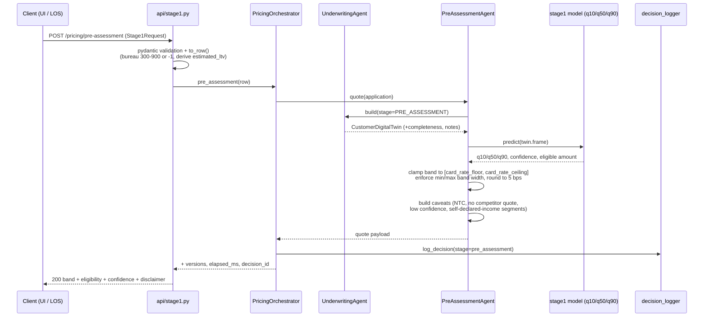
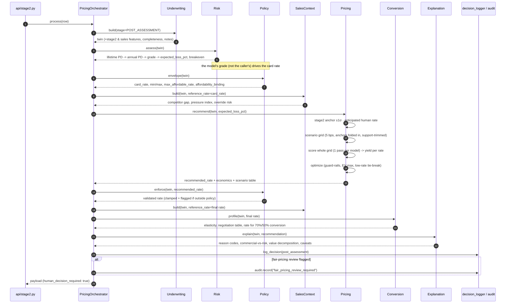
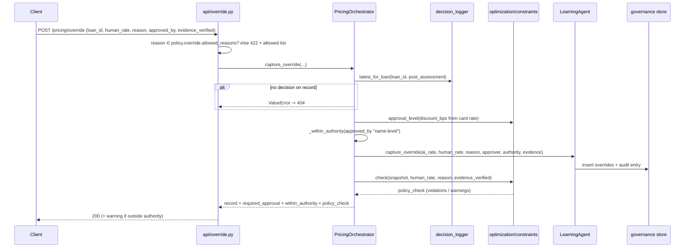
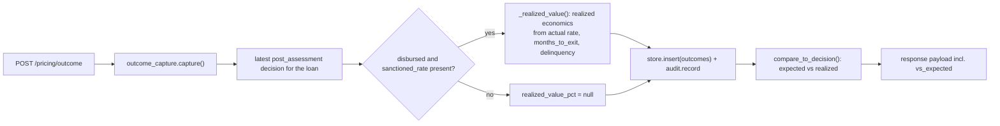
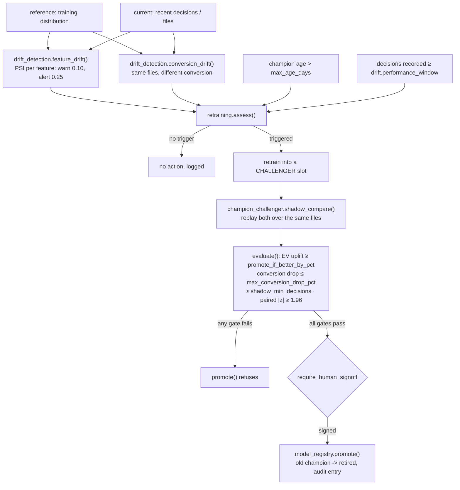
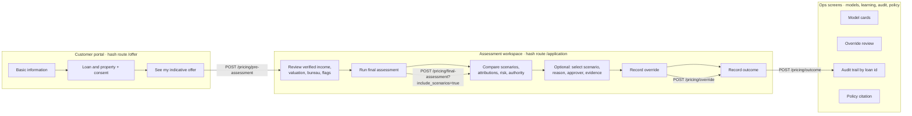

# Flows

What actually happens, step by step, for every path through the system. Structure and
component responsibilities are in [architecture.md](architecture.md).

| # | Flow | Trigger |
|---|---|---|
| [F1](#f1--stage-1-pre-assessment) | Stage-1 pre-assessment | `POST /pricing/pre-assessment` |
| [F2](#f2--stage-2-final-assessment) | Stage-2 final assessment | `POST /pricing/final-assessment` |
| [F3](#f3--human-override-capture) | Human override capture | `POST /pricing/override` |
| [F4](#f4--outcome-capture) | Outcome capture | `POST /pricing/outcome` |
| [F5](#f5--override-learning-review) | Override learning review | `GET /pricing/learning/override-review` |
| [F6](#f6--drift--retraining--promotion) | Drift → retraining → promotion | Scheduled / manual |
| [F7](#f7--data-generation-and-training) | Data generation and training | `make data`, `make train` |
| [F8](#f8--model-level-xai-run) | Model-level XAI run | `make xai` |
| [F9](#f9--ui-journey) | UI journey | Browser |
| [F10](#f10--policy-citation) | Policy citation | `GET /pricing/policy/explain` |
| [F11](#f11--degradation-paths) | Degradation and guard-rail paths | Any |

---

## F1 — Stage-1 pre-assessment

Income is self-declared, the property may be unvisited, there may be no bureau file.
A single precise rate here is a promise the underwriter has to break, so the answer is a band.



Band discipline ([stage1/predict.py](../src/aavas/models/stage1/predict.py)):

1. independently fitted quantile models can cross on thin slices → `low, high = min, max`, `mid` clipped inside;
2. width clamped to `[min_band_width_bps, max_band_width_bps]` around the midpoint — too tight is
   falsely precise, too wide is not a quote;
3. rounded to `round_to_bps`, then clipped to the product envelope;
4. eligibility computed at both ends of the band, with the **binding constraint** named
   (LTV cap, FOIR cap or requested amount).

Errors: missing `stage1` artefact → `503`; anything else → `500` with the loan id logged.

---

## F2 — Stage-2 final assessment

The main flow. Numbered steps match
[`orchestrator.process()`](../src/aavas/agents/orchestrator.py).



### What each step contributes to the payload

| Step | Payload key | Contains |
|---|---|---|
| Underwriting | `twin`, `application_snapshot`, `notes` | The file as priced, completeness ratio, human-readable observations |
| Risk | `risk` | `pd`, `lifetime_pd`, `lgd`, `risk_grade`, `expected_loss_pct`, `breakeven_rate` |
| Policy envelope | `envelope` | `card_rate`, `min_rate`, `max_rate`, `max_affordable_rate`, `affordability_binding`, `infeasible` |
| Pricing | `recommendation` | `recommended_rate`, `economics`, `value_decomposition`, `binding_constraint`, `scenarios_rejected`, `marginal_analysis`, `comparisons`, `stage2_anchor`, `scenarios`, (`scenario_table` on request) |
| Policy enforce | `policy` | `allowed`, `discount_bps`, `required_approval`, `violations`, `warnings`, `permissible_band`, `policy_version` |
| Sales context | `sales_context` | Competitor claim + status, pressure index, `override_risk` |
| Conversion | `price_sensitivity` | `conversion_at_recommended`, points lost per 25/100 bps, sensitivity label, negotiation table |
| Explanation | `explanation` | `reason_codes`, `attribution_method`, `commercial_vs_risk`, `negotiation_guidance`, `policy_position`, `fair_pricing_review`, `customer_caveats`, `actionable_for_customer`, `disclaimer` |
| Versions | `model_versions`, `versions` | Per-model versions + policy/feature/model-config versions |

### The scenario search in detail

```
permissible band  ──► grid at optimizer.step_bps (5 bps)
                      + card_rate, policy floor/ceiling
                      + stage2_anchor
                      + competitor_match        (if inside the band)
                      + anticipated_human_rate  (if override probability ≥ 0.5)
                      ─ trimmed to the conversion model's support band
                          "upper end trimmed from 16.50% to 13.73%: beyond that the
                           conversion model is extrapolating, not predicting"

for each rate:  P(conversion)  P(BT-out) ─► expected life
                lifetime value = (rate − funding − servicing − capital − EL)
                                 × avg outstanding × annuity + fee − acquisition
                expected value = P(conversion) × lifetime value

reject:   conversion < optimizer.min_conversion_probability (0.25)
          BT-out     > optimizer.max_bt_out_probability     (0.45)
choose:   max expected_value_inr; ties within ev_tolerance_pct → lowest rate
fallback: if every scenario breaches a guard-rail → most convertible price,
          binding_constraint says so loudly
```

Anchors are folded into the grid so the `comparisons` block can answer "why not the card
rate / the competitor's rate / the price the salesperson would have offered?" with the exact
value difference in rupees. `marginal_analysis` steps by the configured increment (not the
adjacent row, which can be 1 bp away because of the folded anchors).

---

## F3 — Human override capture

The recommendation is never replaced; both numbers are stored.



Two rules that bite here:

* **Evidence.** `competitor_lower_rate` and `customer_threatening_bt` may not move the price
  more than `max_unevidenced_discount_bps` (15) without verified evidence:
  `POLICY BLOCK reason 'competitor_lower_rate' requires evidence for a discount above 15 bps (requested 20 bps)`.
* **Authority.** Recording is not approving. If `within_authority` is `false`, the response
  carries a warning that it must not be released to the customer without that approval; the
  UI blocks progression to a disbursed outcome.

The policy re-check runs against the **stored application snapshot**, not a re-supplied
payload, so the human's price is judged against the file as it was priced.

---

## F4 — Outcome capture

A pricing decision is scored when the loan has disbursed, run, and either survived or
transferred out — not at sanction.



`outcomes` is keyed by `loan_id` (`INSERT OR REPLACE`), so a later LMS feed updates the same
row as the file matures, while `decisions` and `audit_log` stay append-only.

---

## F5 — Override learning review

The question the brief asks — *did overrides improve conversion and long-term yield?* —
answered twice, because the naive answer is wrong.

```
                       ┌────────────────────────────────────────┐
training table ───────►│ naive_comparison()                     │──► "overrides look bad"
                       └────────────────────────────────────────┘
                       ┌────────────────────────────────────────┐
override model ───────►│ propensity = P(override | file)        │
                       │ bucket files by propensity             │
                       │ compare overridden vs not WITHIN bucket │──► adjusted effect
                       │ standard error + sample-size floor      │    (+ "insufficient
                       └────────────────────────────────────────┘     evidence" on thin slices)
                                     │
                                     ├──► reason_league_table()      per-reason verdicts
                                     ├──► evidence_effect()          evidenced vs unevidenced
                                     └──► suggested_adjustments()    capped at ±15 bps,
                                                                     a PROPOSAL to the committee
```

The response always carries `naive_comparison`, `adjusted_overall`, `confounding_gap_inr` and
a `method_note` stating that this is stratification, not a randomised test. Salespeople
discount precisely the files that were hardest to close, so most of the apparent damage in
the naive read is selection, not decision quality.

`GET /pricing/learning/questions` wraps the same machinery as answered standing questions,
plus `recommendation_quality` (was the engine too aggressive or too soft versus what humans
actually did).

Both endpoints read the **training table**, not just outcomes recorded through the API — they
return `503` if `data/processed/training_data.csv` has not been built.

---

## F6 — Drift → retraining → promotion



Conversion drift is the dangerous one: the model keeps looking confident while its demand
curve is stale, and no input-distribution monitor would notice.

---

## F7 — Data generation and training

```
make data ──► src/aavas/synthetic/generator.py
              identity/time → customer → property & ticket → latent PD/LGD
              → sales context → latent price elasticity
              → legacy recommendation + override → customer response
              → post-disbursal behaviour → realized yield
              → historical Stage-1 quote → drop files credit would decline
              writes data/raw/home_loan_data.csv + sales_notes.csv

make train ──► scripts/train_all.py
               loader.build_training_table()
                 add_derived_columns()  offered_rate, competitor_gap_bps,
                                        was_overridden, total_discount_bps, month
                 validator.validate() + quarantine()   (policy-impossible rows out)
                 writes data/processed/training_data.csv
               loader.train_test_split(strategy="time")   chronological 80/20
               for each of stage1, stage2, conversion, prepayment, risk, override:
                 features from config/feature_config.yaml → FeatureTransformer.fit
                 fit learner (monotone constraints from the contract)
                 calibrate probabilities (isotonic) where they feed money maths
                 evaluate on the holdout → ModelCard(metrics, window, limitations)
                 base.save() → models/<name>__v1.joblib + .card.json
                 model_registry.register(card, role="champion")
```

Generator properties that make the POC meaningful: each file carries a latent
`price_elasticity` the conversion model has to recover (rank correlation ≈ 0.47), and
overrides are informative — some create value, some destroy it, so the override-learning
module has to tell them apart. Files that breach hard policy are dropped as
"declined at credit", so every surviving row is policy-consistent.

A **time-based** split is used deliberately: pricing is non-stationary and a random split
flatters the model.

---

## F8 — Model-level XAI run

```
make xai-install ──► scripts/setup_xai_env.sh
                     builds .venv-xai with --system-site-packages
                     (inherits numpy/pandas/sklearn so artefacts load unchanged;
                      shadows only the packages omnixai pins differently: dash, Flask, shap.
                      omnixai itself is installed --no-deps: its own pins predate this stack)

make xai ─────────► .venv-xai/bin/python scripts/run_omnixai.py
   per model:  load artefact + its holdout, split exactly as training split it
               ├─ global: KernelSHAP + permutation importance  → Spearman rank agreement
               ├─ global shape: PDP + ALE
               ├─ instance: KernelSHAP vs LIME                 → top-3 agreement
               ├─ instance: MACE counterfactuals               (may be unavailable — said so)
               ├─ dataset: correlation, mutual information, imbalance, chi-square
               └─ prediction: ROC/PR, confusion, residuals
   writes reports/omnixai/<model>/{report.md, global_importance.csv, analysis.json}
   serves one dashboard per model process (default 3, --max-dashboards raises it)

make xai-reports ─► same analysis, --no-ui (nothing to Ctrl-C)
make xai ARGS="--fast"                smaller samples, no counterfactuals
make xai ARGS="--models stage2 conversion --instances 8"
```

A runtime shim in `xai/omnixai_analysis.py` handles `shap >= 0.45` returning a single
`(rows, features, classes)` array where omnixai indexes `shap_values[label][row]` — left
alone, that index silently returns a *row*, making every classification attribution wrong
rather than broken.

---

## F9 — UI journey

Routes are hash-based: `#/offer`, `#/application`, `#/dashboard`, `#/models`, `#/learning`,
`#/audit`, `#/policy`.



UI rules worth knowing when reading the code:

* changing application data clears `pre`, `final`, `override` and `outcome` — stale results are
  never shown against edited inputs, and repricing is required;
* `runFinal()` silently runs the pre-assessment first if it is missing, so the journey is
  always complete in the audit trail;
* a saved override is not an approval: policy violations or insufficient authority block
  progression to a disbursed outcome;
* `/health` is polled every 30 s and drives the footer connection state and version stamps.

---

## F10 — Policy citation

`GET /pricing/policy/explain?question=...` →
[`PolicyRetriever.cite()`](../src/aavas/knowledge/policy_indexer.py) → the vector store
(in-memory TF-IDF by default) over clauses generated from `pricing_policy.yaml`. The answer
is the **policy text itself**, with metadata, so a branch question ("what is the branch
manager discount limit?") is answered by the clause that governs it rather than by a
paraphrase. `PolicyRetriever.explain_limit(discount_bps)` does the same for a specific
deviation size.

---

## F11 — Degradation paths

Each of these is a designed path, not an error, and each announces itself in the payload.

| Condition | Behaviour | Where it surfaces |
|---|---|---|
| Model artefacts missing | Warning logged; `/health` returns `degraded` + `models_missing` | `health`, orchestrator log |
| `stage1` artefact missing | `503` with "run scripts/train_all.py" | `POST /pricing/pre-assessment` |
| `stage2` missing | Search anchored on the card rate | `notes`, `stage2_anchor.source = card_rate` |
| `risk` missing | Grade taken from the file, expected loss 0, source `unavailable` | `risk.source`, `notes` |
| `conversion` missing | `price_sensitivity.available = false` | payload + `notes` |
| Recommendation outside policy | Clamped into the band, original violations preserved | `policy.clamped_from`, `policy.original_violations`, `notes` |
| No affordable rate inside the band | `envelope.infeasible = true`; scenarios collapse to the floor | `envelope`, `scenarios.notes` |
| Conversion model extrapolating | Search band trimmed, or flagged low-confidence if there is no overlap | `scenarios.notes` |
| Every scenario breaches a guard-rail | Falls back to the most convertible price | `binding_constraint`, warning log |
| Competitor quote below the permissible floor | Kept as context, cannot be matched within policy | `scenarios.notes` |
| Unevidenced competitor claim | Discount capped at 15 bps, blocked above it | `policy.violations` / `warnings`, `notes` |
| Commercial factors priced the customer up | `fair_pricing_review.flagged` **and** an audit entry | `explanation`, `audit_log` |
| shap broken or absent | Ablation explainer; method reported | `explanation.attribution_method` |
| Sales-note index unavailable | Logged, context omitted | server log |
